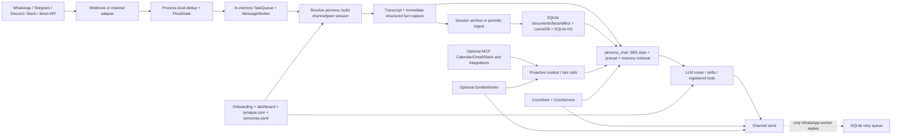

# Current Synapse architecture (source audit, 2026-09-25)

This describes the code as wired, not a live service guarantee. The first-pass [memory and personality audit](./initial/audit.md) and [source evidence](./initial/architecture.md) remain unchanged copies of the original reports. The companion [architecture evidence](./architecture-evidence.md) covers targeted scheduler and channel probes. No private conversations, credentials, or live accounts were inspected. The code-review graph CLI was unavailable in this Windows environment, so this audit used narrow source reads.

## Runtime map

**Inbound and turn ownership.** The gateway starts channel adapters, an in-memory queue and workers, optional WhatsApp retry queue, MCP connections, cron service, and optional proactive loops ([api_gateway.py](../../../workspace/sci_fi_dashboard/api_gateway.py#L93-L155), [api_gateway.py](../../../workspace/sci_fi_dashboard/api_gateway.py#L252-L323), [api_gateway.py](../../../workspace/sci_fi_dashboard/api_gateway.py#L328-L404)). Telegram and Discord registration requires configured tokens ([channel_setup.py](../../../workspace/sci_fi_dashboard/channel_setup.py#L52-L100)). The WhatsApp webhook normalizes messages, filters status events, deduplicates, and passes messages to FloodGate ([routes/whatsapp.py](../../../workspace/sci_fi_dashboard/routes/whatsapp.py#L28-L98)); dedup and FloodGate state are process-local ([gateway/dedup.py](../../../workspace/sci_fi_dashboard/gateway/dedup.py#L18-L62), [gateway/flood.py](../../../workspace/sci_fi_dashboard/gateway/flood.py#L4-L37)). The queue is in memory ([gateway/queue.py](../../../workspace/sci_fi_dashboard/gateway/queue.py#L41-L55)). The durable transcript append happens later in the worker's pipeline, before model generation ([pipeline_helpers.py](../../../workspace/sci_fi_dashboard/pipeline_helpers.py#L1497-L1517)). Thus a webhook can acknowledge a message that is still only in process memory. An inbound SQLite helper exists in `whatsapp_bridge.py`, but this audit did not find it called from the active webhook path.

**Person, session, and personality.** Channel chat resolves a *persona* from configured phone substrings or keywords, otherwise `the_creator` ([pipeline_helpers.py](../../../workspace/sci_fi_dashboard/pipeline_helpers.py#L1393-L1414), [_deps.py](../../../workspace/sci_fi_dashboard/_deps.py#L242-L254)). The shipped [personas.yaml](../../../workspace/personas.yaml) leaves both creator and partner mappings empty. Session keys default to per-channel peer and can explicitly link peer IDs across channels ([multiuser/session_key.py](../../../workspace/sci_fi_dashboard/multiuser/session_key.py#L62-L123)). This isolates recent transcripts but does not establish a verified human identity. First-contact owner registration separately records one peer per channel under `the_creator`; persona resolution does not consult that map ([channel_setup.py](../../../workspace/sci_fi_dashboard/channel_setup.py#L23-L32), [owner_registry.py](../../../workspace/sci_fi_dashboard/owner_registry.py#L55-L83)). SBS orchestrators are instantiated per persona, rather than per person ([_deps.py](../../../workspace/sci_fi_dashboard/_deps.py#L217-L220)). Consequently, separate peers assigned the same default persona can share a learned style/profile even while their immediate sessions differ. The code has no demonstrated consented household preference scope or separate “use for joint recommendation” and “quote to partner” grants.

**Memory and reply generation.** Each normal channel turn appends role/content to a session transcript and immediately extracts recognized structured facts ([pipeline_helpers.py](../../../workspace/sci_fi_dashboard/pipeline_helpers.py#L1497-L1530)). `/new` and periodic flush ingest broader dialogue into document/vector/KG stores; this is delayed and can fail independently ([session_ingest.py](../../../workspace/sci_fi_dashboard/session_ingest.py#L289-L485)). `persona_chat` retrieves memory, constructs style and prompt context, routes to model providers, and may execute skills or registered tools ([chat_pipeline.py](../../../workspace/sci_fi_dashboard/chat_pipeline.py#L2030-L2125), [chat_pipeline.py](../../../workspace/sci_fi_dashboard/chat_pipeline.py#L2218-L2280), [chat_pipeline.py](../../../workspace/sci_fi_dashboard/chat_pipeline.py#L3099-L3320)). Tool-call receipts can suppress unverified claims in reply text ([action_receipts.py](../../../workspace/sci_fi_dashboard/action_receipts.py#L102-L132)), but a text guard is not a channel delivery receipt. The earlier audit documents ownerless vector/KG retrieval, indexing fallback, coarse time/affect grounding, and casual reply memory budgeting.

**Tools and external context.** The regular tool registry includes web query and direct Calendar functions ([tool_registry.py](../../../workspace/sci_fi_dashboard/tool_registry.py#L306-L475), [tool_registry.py](../../../workspace/sci_fi_dashboard/tool_registry.py#L708-L727)). The optional MCP client connects configured built-in memory, conversation, tools, Gmail, Calendar, and Slack servers, and configured custom servers; it discovers their tool schemas and calls them by name ([mcp_client.py](../../../workspace/sci_fi_dashboard/mcp_client.py#L29-L109), [mcp_client.py](../../../workspace/sci_fi_dashboard/mcp_client.py#L138-L163)). The gateway connects MCP only when enabled in loaded configuration ([api_gateway.py](../../../workspace/sci_fi_dashboard/api_gateway.py#L252-L281)). Integrations define Calendar/Gmail OAuth scopes, but the bundled Google client ID is explicitly a placeholder ([integrations/registry.py](../../../workspace/sci_fi_dashboard/integrations/registry.py#L21-L56)). Tokens are stored under one service path per local installation, without a person key ([integrations/token_store.py](../../../workspace/sci_fi_dashboard/integrations/token_store.py#L22-L32)). MCP tool availability therefore does not by itself prove a connected account, correct account ownership, fresh result, or permission for a particular person. This audit found no built-in Maps/traffic capability in the active MCP server list. A bundled weather skill exists, but no source-backed path from a Calendar event to travel-time/weather re-evaluation and departure dispatch was found.

**Background and delivery.** CronService and CronStore support persisted jobs and recurring evaluation; gateway wires the cron execution adapter to `persona_chat` with fixed target `the_creator` ([api_gateway.py](../../../workspace/sci_fi_dashboard/api_gateway.py#L283-L323)). The optional proactive engine polls configured MCP Calendar/Gmail/Slack sources and creates check-in context; `GentleWorker` sends when its policy allows ([proactive_engine.py](../../../workspace/sci_fi_dashboard/proactive_engine.py#L63-L143), [gentle_worker.py](../../../workspace/sci_fi_dashboard/gentle_worker.py#L212-L288)). These are real foundations, but generic polling/check-ins are different from durable, event-owned departure jobs. Normal worker replies route through the channel sender and WhatsApp can enqueue failed chunks in a SQLite retry queue ([gateway/worker.py](../../../workspace/sci_fi_dashboard/gateway/worker.py#L137-L264), [gateway/retry_queue.py](../../../workspace/sci_fi_dashboard/gateway/retry_queue.py#L27-L68)). Cron/proactive paths send outside that worker retry path. WhatsApp `send` reports HTTP outcome, not accepted/delivered/read transport stages ([channels/whatsapp.py](../../../workspace/sci_fi_dashboard/channels/whatsapp.py#L494-L512)); webhook status handling is marked for future tracking ([routes/whatsapp.py](../../../workspace/sci_fi_dashboard/routes/whatsapp.py#L44-L52)).

## User scenarios through current wiring

**Tuesday: “Remind me Saturday morning about our date.”** The reminder parser recognizes concrete dates and times and the CronStore can persist a future job across service restart (see companion evidence). An explicit schedule is stronger than hoping memory recalls it. At the due time, the gateway cron adapter generates a response and sends directly. A targeted synthetic failed-send probe found that a one-shot job was marked `ok`, its next run cleared, and the worker's WhatsApp retry queue was never invoked. A delivered Saturday message therefore is not guaranteed merely because the job fired. The default persona mapping also makes partner routing unreliable. No consensual shared-taste model was identified to draw joint suggestions from.

**Known 5 p.m. date: “Tell me when to leave based on traffic and weather.”** Current Calendar/Gmail MCP servers and proactive polling can expose event context when configured, and web query can discover general information. The inspected runtime does not own a persisted departure opportunity tied to event ID/version, continuously reconcile changed or cancelled events, compute departure from live Maps ETA plus preparation buffer, recheck conditions near departure, and deliver through a common durable outbox. Menu/traffic/weather claims must therefore be treated as unavailable unless an actual connected tool returns fresh evidence. This is an absent end-to-end product guarantee, not proof that every external service is unusable.

## Status and limits

The foundations are substantial: common chat pipeline, sessions, long-term stores, model routing, tool loop, Calendar/Gmail integration scaffolding, persistent cron jobs, and a WhatsApp retry mechanism. The high-impact missing contract is **person-owned, event-owned, durable action from input through verified delivery**. Targeted synthetic probes and source tracing establish the failure paths above; no live provider/channel account was exercised. The current implementation should be evaluated against longitudinal multi-person scenarios before claiming the envisioned personal-assistant behavior.
