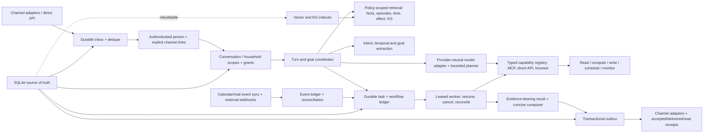

# Proposed architecture: a durable general personal assistant

**Status: proposal, not implemented.** This design starts from the [current runtime map](./current-architecture.md). The user-facing contract is simple: Synapse understands a supported goal, uses authorized capabilities to do the work, survives disconnect/restart, and reports only outcomes it can verify. Calendar, travel, research, messaging, and shopping are examples of one general workflow, not separate assistant architectures.

## Contracts and boundaries

**A modular monolith with a durable worker is enough initially.** Keep the existing gateway, session handling, stores, router, tool loop, and channel adapters. Add explicit inbox, task/workflow, event, consent, and outbox records in one transactional source of truth, initially SQLite with migration discipline. The existing JSON cron state and SQLite memory cannot simply be declared one transaction; migrating scheduled jobs without duplicate sends or silent loss is a real rollout risk. A separate worker process may use the same modules and database, but no swarm or microservice split is needed to provide the guarantee. The host must be on and reachable at due time; offline desktop installs need a documented missed-run policy or an always-on deployment option.

**Identity and memory are person-owned.** Every inbound envelope carries channel, peer, external message ID, account, observed time, and raw transport receipt. Explicitly link channels to one authenticated person; a common phone substring or first-contact slot is not identity proof. Store conversation, household, and grant scopes separately. One physical database is fine if every document, vector row, graph node/edge, profile, and traversal enforces owner and grant filters. Store stable memory ID, source/provenance, event time, observed time, confidence, supersession/correction state, retention, and index freshness. SQLite is authoritative; LanceDB and KG are rebuildable projections. A revoked or deleted memory must be filtered by the source-of-truth tombstone immediately, even while derived indexes are being purged and rebuilt.

**Shared context requires explicit, narrow consent.** Two people can opt specific preferences or categories into a shared relationship scope. A grant to *use* a preference in a mutual recommendation is distinct from permission to *quote* it to the partner. Both parties consent to shared use, and either can revoke. The assistant does not pool raw private transcripts by default. The task executor rechecks grants at action dispatch, not merely at planning, so a revocation racing a queued suggestion prevents stale shared context from leaking. Per-person style is learned from that person’s own behavior and expressed preferences; it must not be guessed from labels such as “partner” or gender.

**One recognizable identity, multiple relationships.** Keep a stable, transparent AI identity and core behavior rules; add versioned, bounded per-person relationship style and temporary affect as separate layers. Let the style learn with feedback and roll back. The assistant may change wording and preferred level of detail, not silently rewrite its own code, safety policy, or core prompt. Prompt assembly should reserve a small grounded episodic budget even for casual turns, apply a relevance/abstention threshold, respect corrected facts, and keep replies brief unless the user asks for depth. Natural recollection requires event-time evidence: if time or emotion is inferred weakly, speak generally instead of fabricating a specific “Tuesday night when you were stressed.”

**The model is replaceable, the task contract is not.** A provider-neutral adapter negotiates actual model limits: context size, tool-call/schema support, multimodal input, and reasoning reliability. Routing can select models by task and cost. The model proposes a plan within available typed capabilities; a deterministic coordinator validates tool arguments, scopes, policy, temporal logic, side effects, and evidence before execution. A weaker model can be supported without promising identical quality. When a capability is missing or unhealthy, Synapse says what it cannot verify instead of inventing a result.

**Typed capabilities and trustworthy evidence.** A registry exposes read, compute, write, schedule, and monitor capabilities through MCP, direct APIs, or browser automation where needed. Discovery checks input/output schemas, connected account, per-person OAuth scope, health, rate limits, and revocation. MCP is transport and tool discovery, not proof of data quality or authorization. Each result records source, subject, observed time, valid-until time, units, timezone, uncertainty, error class, and action receipt. Email and webpage content are untrusted data, never instructions to override the user’s request or policy. Calendar read/write, mail read/send, Maps, weather, and merchant ordering are distinct permissions. Credentials are referenced per person and service, not inserted into prompts. Factual claims about venues, menus, ETA, forecast, order status, or scheduled delivery require fresh source evidence appropriate to that claim.

**Tasks persist beyond chat.** The coordinator distinguishes an immediate answer from a durable goal. A request to remind, monitor, research later, send, or purchase becomes a deterministic task/workflow record with owner, goal, parameters, state, version, due time, timezone, cancellation state, checkpoints, retry budget, and idempotency/attempt IDs. Clarify only missing details that matter to doing the task, such as the intended Saturday, location, or payment limit. A task can continue after the chat disconnects. A leased worker resumes safely after restart; cancellation or changed permission invalidates queued work through a version and grant recheck immediately before dispatch. One transactional outbox carries replies, reminders, proactive suggestions, and workflow results through adapters. Record accepted, delivered, and read distinctly where the provider supports them. Delivery is at-least-once with dedupe where possible, never claimed exactly-once across an external provider.

**Side effects are bounded by the user’s authorization.** Read-only research can proceed within connected permissions. Scheduling a requested reminder is a direct authorized action once date/time/channel are clear. Booking, purchasing, contacting a third party, or sending mail follows the actual authorization envelope. For an order, inspect item, quantity, merchant, address, payment method, total/currency, and a quote snapshot with expiry. If the user’s request already specifies exact acceptable terms, that is authorization; do not impose a ritual second approval. Pause for material ambiguity, changed price/terms, reauthentication, OTP, or CAPTCHA, and never substitute another payment or top up a wallet without permission. Persist side-effect attempt IDs and use provider idempotency when available. After a timeout, reconcile order history or provider state before retrying, avoiding duplicate purchases. Claim success only with a read-after-write receipt. Merchant automation remains unverified until a real supported integration is exercised.

## Three acceptance journeys

1. **Tuesday → Saturday reminder.** Parse event date/time separately from reminder due time and person timezone; clarify which “Saturday” or what “morning” means if unresolved, while accepting explicit preferences. Commit a task, then confirm it is set. Restart before Saturday, deliver through the common outbox, observe a transport receipt, and prove cancellation/version changes prevent a send. If suggestion research fails, deliver the plain reminder on time and offer later enrichment within a bounded window.
2. **5 p.m. date → departure guidance.** With the person’s Calendar grant, synchronize event changes through webhook or bounded polling, dedupe by event ID/version, and reconcile cancellation/reschedule. Persist an opportunity job. Compute the next evaluation from event start minus estimated travel, preparation, and safety buffer; re-evaluate only on meaningful change or freshness expiry. Near departure, query authorized Maps traffic and weather, and an actual venue/menu source if requested. Send a concise actionable update with source/freshness. If traffic is unavailable, use a clearly calibrated fallback and never fabricate ETA or venue details. Quiet hours and frequency policies govern optional nudges but cannot silently cancel an explicit reminder.
3. **“Order these products for me.”** Discover an authorized merchant capability and inspect the current cart/quote. Validate exact user constraints. Execute only within that envelope, checkpoint before external side effect, reconcile after uncertain response, and report the order ID/receipt or an honest pending/error state. A chat disconnect or worker restart cannot erase or blindly replay the operation.

## Proof before claiming completion

Use synthetic, two-person longitudinal tests that cross `/new`, process restart, and channels; include corrected facts, affect/time grounding, joint recommendation with use-vs-quote grants, and immediate revoke. Then test a scheduled reminder through a failed send and retry, event reschedule/cancel, stale search/failed Maps response, no fake venue claim, and a side-effect timeout that reconciles before retry. Finally run an opt-in live canary on actual connected accounts/channels with no purchase or third-party contact unless specifically authorized. Measure memory precision/recall, task completion, false success claims, and actual transport receipts separately from tests that only assert a function returned.
